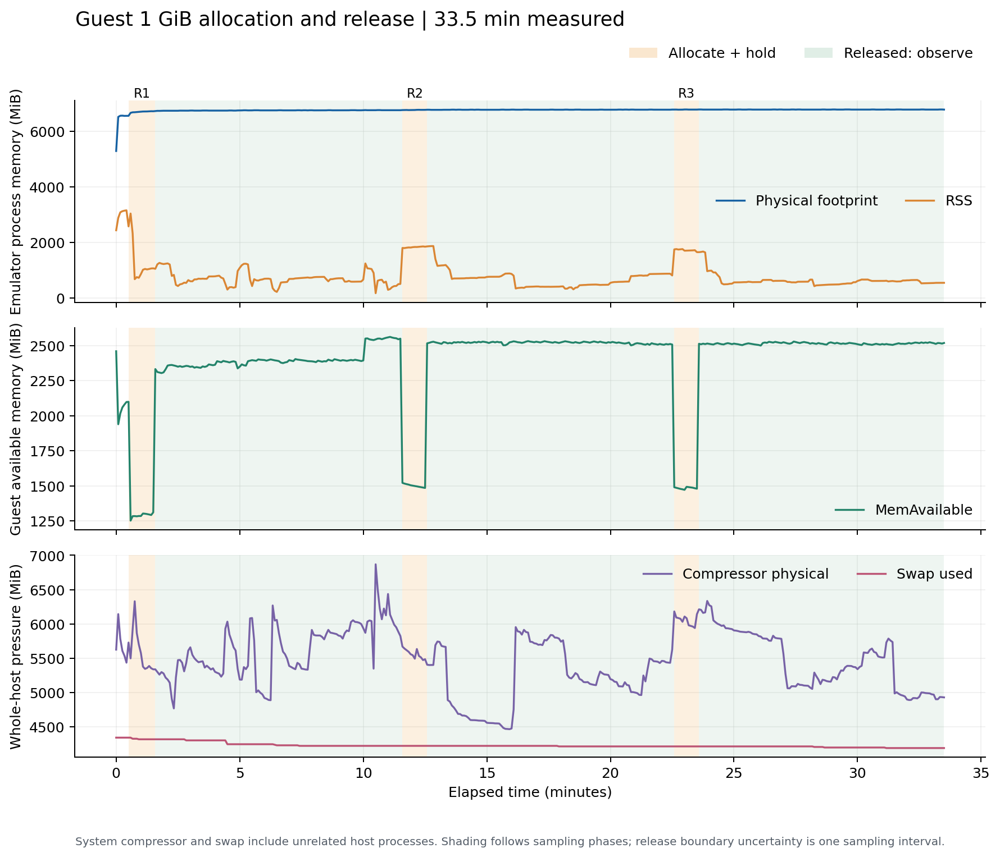

# 官方 AVD：1 GiB 分配与释放测量分析

三轮均完成 1 GiB 非零逐页触碰、约60秒持有、成功 munmap 和完整600秒观察。客体 MemAvailable 在释放后回升约 1024–1258 MiB；**未观察到模拟器进程 phys_footprint 出现 GiB 量级净下降**：三轮末窗差分别为 +38.00、+5.52、−0.16 MiB。RSS 同期下降不等同于 phys_footprint 回落，不能据此宣布宿主内存回收成功，也不能将这一有限试验判为内存泄漏。

## 测量窗口与负载核验

- 时间：2026-11-01 10:38:29–11:12:01（Asia/Shanghai）；总运行 2011.778 秒，CSV 有 403 个样本，宿主/客体采样错误均为0。实际采样间距 4.992–5.008 秒，单次采样耗时 19.956–102.405 ms。
- 环境：Apple M4、16 GiB 宿主内存；官方 API34/arm64-v8a guest，客体页4096字节，宿主页16384字节。配置为4核/4096 MiB guest RAM、host GPU、无窗口且不使用快照。此项没有游戏工作负载。
- 探针每隔4096字节执行 volatile 写入 `1 + (page_index % 255)`，共触碰262144页，每页该字节均为1–255；最后一个字节另写0x5A。这里只在每页写少量非零字节，其余大多为零，**高度可压缩，不等同于1 GiB不可压缩游戏工作集**。
- 部署回执、本地二进制和构建manifest的SHA-256一致：`23b6c5ca97cb1d865b3bb0c06c9f54b786e9d5ccc622788dfd34c99605e728ee`。三轮事件都记录1073741824字节，均有 touched/released，退出码均为0。该证据核验写入策略和完整执行；未另做独立逐页内容读回，不夸大为独立完整性校验。

| 轮次 | 实际观察秒（rounds.json） | 释放阶段采样点跨度秒 | 释放阶段样本 | 探针触碰秒 | touched→released秒 |
|---|---:|---:|---:|---:|---:|
| 1 | 600.005295 | 595.000 | 120 | 0.447447 | 60.058901 |
| 2 | 600.005539 | 595.005 | 120 | 0.467607 | 60.050384 |
| 3 | 600.001242 | 594.995 | 120 | 0.575354 | 60.045328 |

600秒是否完成以 `rounds.json` 的单调时钟起止和 `observation_completed` 为准。120个约5秒间隔的采样点，首末点通常只跨595秒；这不表示少观察5秒。

## 每轮宿主进程与客体结果

全部单位为MiB（2²⁰字节）；Δ统一为释放后减持有。持有末3点跨度约10秒，释放末12点跨度约55秒；中位数减少瞬时波动，不是对所有干扰因素的控制。

| 轮次 | 指标 | 持有末3点中位数 | 释放观察末12点中位数 | Δ（释放后−持有） |
|---|---|---:|---:|---:|
| 1 | guest MemAvailable | 1294.74 | 2552.65 | +1257.91 |
| 1 | emulator phys_footprint | 6715.43 | 6753.43 | +38.00 |
| 1 | emulator RSS | 1067.23 | 507.54 | -559.70 |
| 2 | guest MemAvailable | 1486.80 | 2510.48 | +1023.68 |
| 2 | emulator phys_footprint | 6766.41 | 6771.94 | +5.52 |
| 2 | emulator RSS | 1850.64 | 875.52 | -975.12 |
| 3 | guest MemAvailable | 1482.05 | 2519.87 | +1037.81 |
| 3 | emulator phys_footprint | 6775.57 | 6775.41 | -0.16 |
| 3 | emulator RSS | 1716.86 | 543.88 | -1172.98 |

第2、3轮客体可用内存回升接近1024 MiB，符合释放1 GiB匿名映射后恢复可用量的方向。第1轮回升超过1024 MiB，表明 MemAvailable 还受同期客体缓存和其他活动影响，不能把超出的部分全算作探针释放。

phys_footprint 是本次通过 libproc 读取的模拟器进程记账指标；RSS 是其中当前驻留口径，二者不能互相替代。RSS下降只能支持“驻留量下降”这一观测，不能证明减少了相同数量的完整宿主占用，也不能单凭系统压缩/交换计数推出具体机制。净指标变化也不能证明底层从未返还任何单页；其他进程内分配可能抵消释放。

## 全宿主压力背景

以下是**整台宿主**，并非模拟器独占统计。使用相同的每轮中位数窗口，只作同期背景。

| 轮次 | 指标 | 持有末3点中位数 | 释放观察末12点中位数 | Δ（释放后−持有） |
|---|---|---:|---:|---:|
| 1 | 全宿主 compressor physical | 5352.06 | 6095.70 | +743.64 |
| 1 | 全宿主 swap used | 4315.62 | 4219.62 | -96.00 |
| 2 | 全宿主 compressor physical | 5484.14 | 5453.44 | -30.70 |
| 2 | 全宿主 swap used | 4219.62 | 4211.62 | -8.00 |
| 3 | 全宿主 compressor physical | 5960.78 | 4969.69 | -991.09 |
| 3 | 全宿主 swap used | 4211.62 | 4187.62 | -24.00 |

全程 compressor physical 为 4463.16–6868.72 MiB，swap used 为 4187.62–4339.62 MiB，空闲页对应 14.86–360.00 MiB。开头/结尾 compressor physical 分别为 5623.78/4927.14 MiB；swap used 为 4339.62/4187.62 MiB。这是已有明显压缩与交换占用的宿主环境，未隔离其他应用；其增减不能归因于本次 guest 释放。完整CSV还保留全宿主压缩前逻辑页量，以及guest swap计数。

初始30秒仍有明显预热：phys_footprint 从 5287.82 MiB 上升到 6550.90 MiB。全程首末 phys_footprint 增加 1487.61 MiB，不能将该差值直接解释为泄漏。分配/释放之后的额外内部分配、首次启动和系统压力均未被独立控制。

## 可支持的结论与边界

在这台16 GiB M4宿主、现有内存压力、稀疏可压缩触碰负载、三轮各10分钟范围内，客体能够完成分配/释放并恢复约1 GiB可用内存；模拟器进程 phys_footprint 未出现相应GiB量级净下降。该证据不能外推到所有压力条件、不可压缩负载、游戏挂机或更长时间，也不足以判断内存泄漏、balloon机制是否存在或任何具体回收机制的因果效果。

结果属于“测量协议完成，回收效果受上述范围限定”。游戏长时间内存表现仍需独立游戏证据；空载或匿名分配结果不能替代游戏测试。

原始证据：[memory.csv](../results/memory/memory.csv)、[rounds.json](../results/memory/rounds.json)、[round-summary.csv](../results/memory/round-summary.csv)、[运行元数据](../results/memory/metadata.json)、探针部署回执（历史引用，未随公开包提供）。

