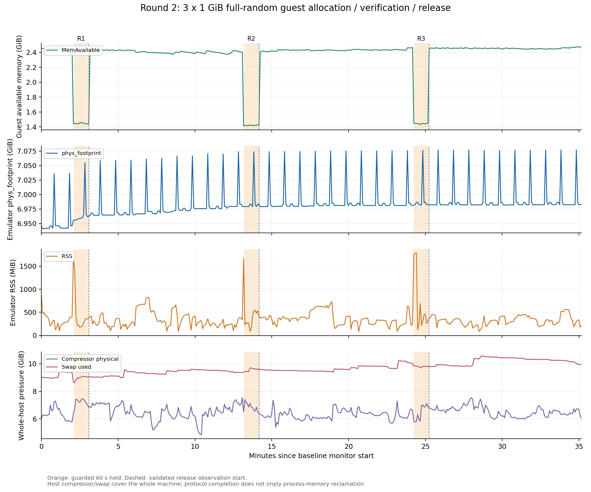

# Issue #28：第二轮增量实测

测试日期为 **2026-11-02，Asia/Shanghai**。承接[第一轮固定证据](https://github.com/DeathofBrain/ModAVD/tree/5d96ba14bb394f8d7fce4d5ffc58eba2afd31c28)，继续使用 Google 官方 Emulator 37.2.13 / API 34 Google APIs ARM64 revision 14；Apple M4、16 GiB、macOS 26.6.2，4 vCPU、4096 MiB、1280×720、HVF、`-gpu host`。未编译或使用 ModAVD。不同阶段的冷启动、日常和长测分开记录。

| 项目 | 本轮结果 | 证据 |
|---|---|---|
| 全量随机内存 3×1 GiB | 每轮完整填充/读验、持有60秒、释放观察600秒完成，423点无采样错误；guest恢复约1 GiB，宿主footprint无对应GiB级下降，但持有增量很小，回收比例无法可靠估计 | [报告与曲线](random-memory-report/report.md)、[原始CSV](random-memory/memory.csv)、[独立解释复核](reviews/memory-interpretation-review.md) |
| 明日方舟与MAA | v6.20.1主页识别失败保留；v6.21.1配套资源下，StartUp→Infrast纯收取→Award三链完成，有实际收取/点击证据 | [公开摘要](maa-reviews/public-summary.json)、[新版审计](maa-reviews/arknights-daily-v6211-review.md)、[旧版失败](maa-reviews/arknights-daily-attempt1-review.md) |
| 明日方舟无头7200秒 | 完整采集，1442内存点/122游戏进程与前台检查均无错误；网络因测试者主动切网而作废，不计模拟器失败 | [独立审计](reviews/headless-game-audit.md)、[原始编排](headless-game-soak/orchestration.json)、[网络说明](reviews/headless-network-diagnosis.md) |
| 真实非空文件持久性 | 可丢弃克隆上136文件基线及120秒观察，未取得满足非空/稳定摘要/完整FD与mmap观测的候选，blocked；未执行no-sync内容比较 | [报告](reviews/nonempty-file-review.md)、[逐步记录](nonempty-file/0d15480982dd.json) |
| 阴阳师2.8.89 | 安装成功、选中ARM64；当前host图形路径只提供ES3.0，NeoX拒绝并发生signal11，进入退出/重启循环，正常进入失败 | [独立游戏报告](onmyoji/report.md)、[初次日志摘录](onmyoji/initial-log-excerpt.txt)、[后续摘录](onmyoji/recent-log-excerpt.txt) |
| 原神探索 | ARM64-only APK安装成功并显示登录背景，但未验证进服/玩法；有shader错误，用户换游戏后删除APK及专用AVD | [最小阶段摘要](genshin-exploration.json) |

## 随机内存

负载为ChaCha20-IETF连续伪随机字节流，每轮独立种子，完整重生成并逐字节读验全部1 GiB。先以16 MiB小样本独立Python重生成核验，4096页摘要不重复，zlib比率约1.000306。正式轮次包含120秒基线，每轮填充/读验后持有约60秒，再munmap并完整观察600秒。

单位MiB；采用基线末12点、持有末3点、释放末12点中位数。

| 轮次 | guest MemAvailable释放回升 | footprint持有增量 | footprint释放末窗−持有末窗 |
|---|---:|---:|---:|
| 1 | +993.25 | +21.34 | +16.97 |
| 2 | +1035.35 | +3.81 | −2.14 |
| 3 | +1048.21 | +1.58 | −0.13 |

客体可用量确实恢复，宿主约7 GiB的footprint没有相应下降；本轮完整启动参数也未见balloon设备。这支持继续调查guest→host还页能力，但不证明泄漏、每轮累积1 GiB、具体feature协商状态或与Windows相同根因。分配前footprint已经高，三轮持有增量很小，全机有大量压缩/交换，回收比例保留为null。完整观察窗用单调时钟验收，墙钟调整另记。

## 明日方舟与MAA

游戏为B服2.7.91/code210。使用Maa Verge 0.1.3安装包内runtime/worker，不是dev编译版，也未覆盖Tauri GUI。实际新版会话为18:18:01–18:19:01，MaaCore v6.21.1与同包资源，保持原游戏缩放和主题。

StartUp通过新模板识别；Infrast使用mode=10000、制造/贸易空排班，仅收取，预算为零。核心事件和本地画面交叉确认龙门币增加32,500、装置×1；空计划及保留回调支持本次未换班，但没有完整干员前后名册。Award两次“收集全部”的识别和点击已确认，没有独立完整的奖励到账清单。结果覆盖这组配置的单轮集成链路，不等于全部日常目标或常规自动换班通过。

原始MAA日志、账户余额、登录后截图保留本地；公开审计是派生观察，未公开的来源及其SHA均有说明。

## 无头观察与环境切换

日常后sync停机，同机无头冷启动并确认主页后，18:25:59–20:26:08独立执行7200秒观察；单调耗时7206.761秒。1442内存点跨度7205.007秒，无host/guest采样错误；7230秒游戏观察器的122次主进程/前台检查均正常。保存过26张私有截图，公开包仅包含脱敏观察摘要及样本简表，不公开这些截图。

前末各12点中位数：模拟器footprint增加118.80 MiB，RSS减少220.38 MiB，guest可用量增加109.70 MiB；footprint首末单点差为+121.66 MiB，口径不同。宿主swap/compressor是全机指标，不全归因于模拟器；趋势不能单独证明或排除泄漏。负载为已登录主页驻留，未持续战斗；采样进程存在不证明每秒响应或游戏服务器持续在线。

辅助TCP原始验收确有一次local guest重置，以及远端两路约69分钟后的持续失败。测试者确认期间主动切换网络，明确不计模拟器问题，因此**本轮网络连续性结论作废（invalidated_by_user_network_change）**。原始failed、错误和重连事件保留，没有修改阈值或改成零错误。FakeIP/代理条件及辅助TCP无法代表游戏连接的范围见独立审计。

## 阴阳师失败范围

用户提供的2.8.89/code261014包含ARM64与ARM32各56个库，**不是arm64-only**；用户明确选择继续用该包测试。Android实际选中primaryCpuAbi=arm64-v8a、secondaryCpuAbi=null，guest只支持ARM64，native bridge=0。

两段日志均记录：ES3.2/3.1上下文创建失败→回退实际ES3.0→NeoX打印`GLESDevice only support version above OpenGLES 310 on Mobile`和`Failed to create NeoX Device`→同渲染线程signal11→应用自有handler退出→Android记录EXIT_SELF/status1。当前配置正常进入失败。精确native故障指令尚未回溯，其他图形后端未测；这不外推为所有后端或整个模拟器生态都无法运行。

原神只完成安装/登录背景阶段，未完成arm64-only游戏进服/玩法目标；它的退出测试范围与阴阳师的双ABI性质均保留，不将两者拼成完整arm64-only兼容通过。

## 收尾与校验

阴阳师已sync停机，专用ADB及本轮防休眠进程已结束，独占端口空闲；实例本地保留。原神APK与专用实例按用户要求删除。见[收尾摘要](cleanup-summary.json)。既有数据盘扩容仍沿用首轮失败结论，本轮没有宣称修复或重复做直写对照。

公开包只选取必要证据：不含APK、AVD、密钥、账号/令牌、原始MAA日志、私有路径映射或登录后截图。阴阳师仅公开一张无账号文字的灰白失败图及技术日志摘录。路径、余额和部分私有收据已脱敏；历史SHA指原始本地文件，导出SHA指公开副本。

运行`python3 verify_public.py`核验主包105项；阴阳师有独立[双哈希清单](onmyoji/manifest.json)；`python3 verify_round2.py`核验整个增量包。部分原报告提及的`random-memory-report-diagnostics/`是本地未公开来源，不能将其当公开附件。来源采集/审计脚本依赖原始路径及原始SHA，不能直接把脱敏副本当作未改原件重跑；公开导出以本包验证脚本校验。
