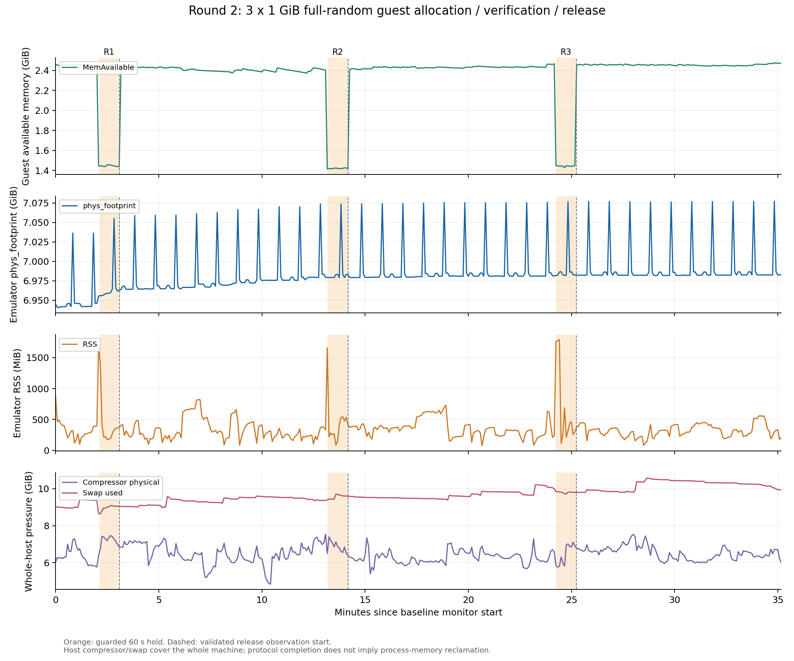

# 第二轮：全量随机内存填充与释放

三轮负载协议均完成，独立重算结果与采集汇总一致。协议完成表示每轮完整写入并逐字节读验 1 GiB、持有约 60 秒、成功 `munmap` 并继续观察至少 600 秒；宿主内存回收另按实际占用增量和释放后的测量值解释。

测量时间：2026-11-02 15:35:54 至 16:11:25（Asia/Shanghai）。

输入目录：`<WORKSPACE>/results/round2/20261102-152442/random-memory`。样本 423 个，目标间隔 5 秒，实测间隔最小／中位／最大为 4.966／5.000／5.035 秒；guest 与 host 错误样本均为 0。

## 采集与验收

使用官方 SDK 的 `official_clean` 无头实例。首次基线至少 120 秒；后续每轮基线取上一轮释放观察的最后一分钟。ChaCha20-IETF 使用 guest `getrandom` 的独立 32 字节种子、全零 nonce 和从 0 连续递增的块计数器；三轮种子与烟测种子互不相同。正式 1 GiB 负载不导出全量内容。

16 MiB 烟测在采集时由独立 Python 实现完整重生成比较，且通过 RFC 8439 已知答案自检。本次复核其 dump SHA-256、zlib 压缩率 1.000306（预设下限 0.99）与 4,096 个互不重复的 4 KiB 页哈希。压缩阈值是本次工程验收条件。

烟测元数据有一项已知限制：1 秒持有也套用了两端各 1 秒的映射 guard，导致其估算窗口为空或倒置。该窗口不参与任何指标计算；烟测真实持有时长另由 guest 原始单调时间核验。三轮正式 60 秒持有区间分别审计。

以下数值由原始 CSV 与 JSONL 事件独立重算，逐项核对 `summary.json`。基线取末 12 点，持有取真实持有窗口内的末 3 点，释放取完整观察窗口末 12 点，各窗口均计算中位数。CSV 的 `allocate_hold` 大阶段包含分配、填充、校验和持有；真实持有边界由 guest 事件与 host 接收锚点计算，两端各排除 1 秒。单向传输绝对延迟未知，不能将这些映射边界当成精确同步的时钟。

| 轮次 | 填充 / 读验（秒） | guest 持有（秒） | 释放观察（秒） | 锚点 offset 跨度（毫秒） |
| --- | ---: | ---: | ---: | ---: |
| 1 | 4.698 / 1.223 | 60.081 | 600.023 | 0.825 |
| 2 | 2.679 / 1.250 | 60.061 | 600.034 | 1.130 |
| 3 | 2.385 / 1.224 | 60.072 | 600.037 | 0.295 |

时间审计保留了一处墙钟限制：UTC 是日历标签，采样节拍、窗口和持续时间均以单调时钟核验。以下 UTC 偏移支持墙钟发生调整，但采集证据未记录校时来源；原始时间戳未修改，三轮 600 秒观察不依赖 UTC 差值。

| CSV 行 | UTC 时间（Asia/Shanghai） | UTC 间隔（秒） | 单调间隔（秒） | 两者之差（毫秒） |
| --- | --- | ---: | ---: | ---: |
| 312 | 2026-11-02 16:02:00.753865 | 4.681587 | 5.000000 | -318.413 |

CSV 全跨度 UTC−单调时钟差为 -320.083 毫秒；整个采集任务起止 UTC−单调 elapsed 差为 -319.401 毫秒。首次报告因错误要求两种时钟每点等速而拒绝生成；该版脚本与诊断记录保存在相邻 `random-memory-report-diagnostics/` 目录。修订后保留全部单调时钟、事件顺序、样本完整性与窗口覆盖检查。

## 三轮关键指标

单位均为 MiB；Δ 为后一个窗口减前一个窗口。Guest 可用内存的分配增量使用“基线 − 持有”，宿主占用使用“持有 − 基线”。回收比例只有分配增量至少达到预设 128 MiB 门槛时才计算，数值不裁剪到 0–100%。

| 轮次 | 指标 | 基线 | 持有 | 释放 | Δ 持有−基线 | Δ 释放−持有 | Δ 释放−基线 | 回收比例 |
| --- | --- | ---: | ---: | ---: | ---: | ---: | ---: | ---: |
| 1 | Guest MemAvailable | 2512.85 | 1474.47 | 2467.72 | -1038.37 | +993.25 | -45.12 | 95.65% |
| 1 | 宿主 phys_footprint | 7108.73 | 7130.07 | 7147.04 | +21.34 | +16.97 | +38.30 | null（增量低于门槛） |
| 1 | 宿主 RSS | 276.52 | 360.78 | 246.21 | +84.27 | -114.57 | -30.30 | null（增量低于门槛） |
| 2 | Guest MemAvailable | 2467.72 | 1459.00 | 2494.35 | -1008.72 | +1035.35 | +26.63 | 102.64% |
| 2 | 宿主 phys_footprint | 7147.04 | 7150.85 | 7148.71 | +3.81 | -2.14 | +1.67 | null（增量低于门槛） |
| 2 | 宿主 RSS | 246.21 | 535.27 | 242.17 | +289.05 | -293.09 | -4.04 | 101.40% |
| 3 | Guest MemAvailable | 2494.35 | 1480.93 | 2529.14 | -1013.42 | +1048.21 | +34.79 | 103.43% |
| 3 | 宿主 phys_footprint | 7148.71 | 7150.29 | 7150.16 | +1.58 | -0.13 | +1.45 | null（增量低于门槛） |
| 3 | 宿主 RSS | 242.17 | 302.83 | 322.97 | +60.66 | +20.14 | +80.80 | null（增量低于门槛） |

三轮 phys_footprint 的持有增量均低于 128 MiB，因此宿主主要口径的回收比例均为 `null`；本次数据不足以可靠估计宿主回收比例。 RSS 为补充指标，应与 phys_footprint 分开阅读。Guest `MemAvailable` 的恢复表明 guest 可用内存变化，不能替代宿主占用的回收证据。本次曲线、差值与三轮重复测试不能单独判定内存泄漏。



图中橙色区域为两端各排除 1 秒后的持有窗口，虚线为释放观察开始；底部压缩与交换曲线覆盖整个宿主。

## 全宿主内存压力背景

| 全宿主字段 | 起始 | 末尾 | 最小 | 最大 | 末尾−起始 |
| --- | ---: | ---: | ---: | ---: | ---: |
| host_compressor_physical_bytes（MiB） | 6183.78 | 6141.12 | 4951.95 | 7719.83 | -42.66 |
| host_compressor_uncompressed_bytes（MiB） | 27866.11 | 28941.30 | 26412.77 | 32624.28 | +1075.19 |
| host_swap_used_bytes（MiB） | 9230.12 | 10180.44 | 8849.19 | 10835.00 | +950.32 |

以上压缩和交换指标包含其他进程及系统活动，不能全部归因于模拟器。宿主起始已经存在的内存压力、已经建立的虚拟机内存映射以及并发活动，均限制了以一次负载推算宿主新增占用及回收量的解释。

## 环境与溯源

```text
ProductName:		macOS
ProductVersion:		26.6.2
BuildVersion:		25G83
hw.memsize: 17179869184
hw.pagesize: 16384
hw.ncpu: 10
machdep.cpu.brand_string: Apple M4
```

探针 binary／构建 manifest／部署 SHA-256 一致：`53b369603b489612873a3a013ae56ce7ba999f589d362588347d5739b35b06a3`。源码、调度器、共享采样器、构建脚本与 AVD 配置的留档 SHA-256 均与采集清单和当前文件一致。

| 文件 | SHA-256 |
| --- | --- |
| `round2_random_memory.py` | `1555febfdcca00c4398049269000156424239cc78b1bb554bc6b865f3339baaa` |
| `soak_tests.py` | `e74122205af13a8f04eb2df8fe910b216504ec3c98c5b6fb43ceab994c46fff8` |
| `avd_probe.c` | `18627cce12e749c6dfc202a6b25da9539d608581afad095155a00093aca02492` |
| `build_probe.py` | `04304a664ff0690e684ce4bfe58cb9920a481e129746c1823c403f80b62dba92` |
| `avd_probe` | `53b369603b489612873a3a013ae56ce7ba999f589d362588347d5739b35b06a3` |
| `config.ini` | `b998cdf98f07c834437a5c3690a5200af8ff0518f15434d564a95753457c276b` |
| `build_manifest.json` | `52eb11f429526aae1e1ad7f97efc72a2bbe086b3554acf2b5623a15411e638db` |

逐项审计回执、重新计算的窗口与完整输入文件哈希见 [audit.json](audit.json)；矢量图见 [memory-timeline.svg](memory-timeline.svg)。历史结果与原始采集目录均保留。
